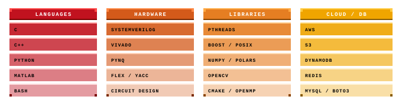

# Archie Kendall

---

## About Me

- Studying Electronics and Computer Engineering at `Imperial College London`
- Industry experience:
  - RF Electronic Engineering, Signal and Data Analysis at `ETL Systems`
  - Aerospace Electronics Engineering + Real-time Control & Filter Algorithm development at `GKN Aerospace`

**Currently building:**
- `AI Inference Accelerator + Driver`: Simulated INT8 GEMM accelerator with a full driver stack
    - 16x16 systolic array, DMA and AXI-Lite control registers in SystemVerilog, simulated with Verilator
    - C/C++ driver and runtime that controls it through memory-mapped registers
- `PYNQZOOM: A Fractal Accelerator on FPGA`: Escape-time fractal renderer running entirely in programmable logic
    - Pool of parallel iterator cores, scheduled by a hardware Mariani-Silver quad-tree
    - Runtime-selectable precision for deep zooms on the PYNQ dev-board

---

## Tech Stacks

  

>

---

## Contribution Graph

  

  

---
